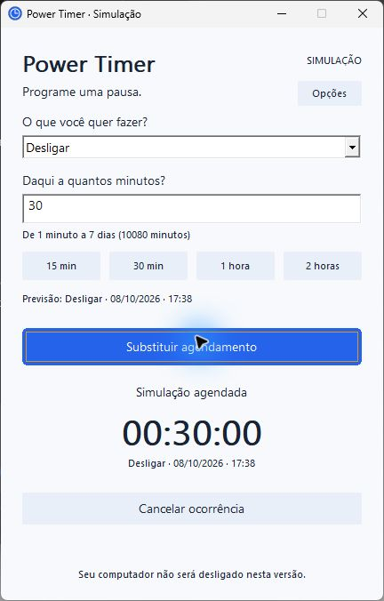

# Power Timer

Agendador minimalista de desligamento, suspensão e hibernação para Windhawk, em desenvolvimento.

A prévia local já permite escolher ação, definir duração de 1 minuto a 7 dias, usar atalhos, acompanhar a contagem e cancelar. **Esta versão funciona exclusivamente em simulação.** Nenhuma ação de energia real é executada.



O núcleo passou por 241 verificações. Preview e DLL x86 compilam; a execução integrada no Windhawk 1.7.3 ainda precisa de validação. Tarefa 02 permanece aberta, antes de persistência e repetição.

- [Validação e limitações atuais](docs/validation/task-02.md)
- [Preparação e instalação local](docs/installation-local.md)
- [Especificação vigente](.scratch/power-timer-v1/spec.md)
- [Mapa das 13 tarefas aprovadas](.scratch/power-timer-v1/map.md)

No PowerShell 7, na raiz do projeto:

```powershell
./scripts/test.ps1
./scripts/build-preview.ps1
./scripts/build-mod.ps1
```

Os scripts usam o compilador instalado com Windhawk. A interface executável fica em `build/preview/`; fonte única para o editor e DLL de conferência ficam em `build/mod/`. Consulte a instalação local antes de ativar o mod.

Publicação no GitHub e no catálogo Windhawk é uma etapa futura, após validação funcional e visual. O repositório é local, sem publicação até aqui.
