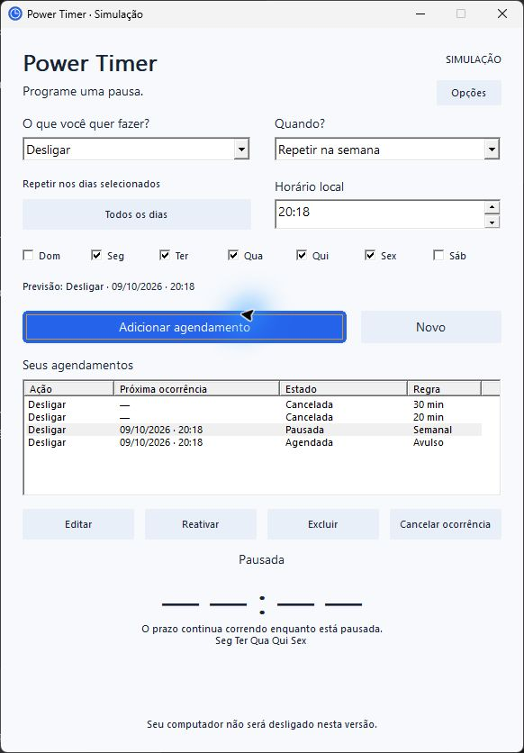

# Crazy Time

[🇧🇷 Português](README.pt-BR.md) · 🇬🇧 English

A minimalist shutdown, sleep and hibernate scheduler for Windows, built as a [Windhawk](https://windhawk.net) mod. Work in progress.

## What it does

Crazy Time schedules shutdown, sleep or hibernate on Windows. Each schedule can be **by duration** (1 minute to 7 days), at a **date and time**, or **repeating on chosen weekdays**. You can keep several schedules at once, edit, pause, cancel a single occurrence, postpone it by 10 minutes, or delete it. The list is restored when the app reopens.

- Countdown warnings at 30, 15, 10, 5 and 1 minute, with optional sound.
- Schedules at the same instant are detected and refused.
- Optional "force apps to close" **per schedule** (shutdown only), off by default, with a data-loss warning.
- Actions this computer cannot perform are explained instead of being scheduled.
- Portuguese and English UI; automatic, light or dark theme; high contrast.

> **The mod really shuts down, sleeps or hibernates your computer** when a schedule fires (`WindowsPowerBackend`). Save your work first, and try a short sleep before relying on it. The real path was manually tested on Windows 11 by the author (report of 2026-10-12, no detailed per-action record). Only the local preview (`scripts/build-preview.ps1`) runs in simulation, using a `SimulatedBackend`, and never touches the computer.



## Status

Tested on Windows 11 with Windhawk 1.7.x. **Windows 10 has not been verified.** It is expected to work, but please report problems. It has not been submitted to the Windhawk catalog yet; see the [release checklist](docs/release-checklist.md). Technical documentation in `docs/` is in Portuguese.

## Install (local build)

**Easy install:** once a release exists, download `crazy-time.wh.cpp` from the [Releases](https://github.com/caikx11/Crazy-timer/releases) page and paste it into the Windhawk editor (steps are in the release notes).

To build it yourself, you need Windhawk with its compiler installed (`C:\Program Files\Windhawk`) and PowerShell.

```powershell
./scripts/test.ps1            # scheduler, schedule book, storage, calendar, warnings
./scripts/test-executor.ps1   # power executor with a fake backend
./scripts/build-preview.ps1   # optional: simulated UI preview in build/preview/
./scripts/build-mod.ps1       # generates build/mod/crazy-time.wh.cpp
```

1. In Windhawk, create a new mod and replace the whole template with the contents of `build/mod/crazy-time.wh.cpp`.
2. Compile it (Ctrl+B) and enable the mod. A tray icon appears.
3. Click the icon to open the panel, pick an action and how it is scheduled, then press **Schedule action**.

Details: [local installation](docs/installation-local.md) (Portuguese).

## How it works

A portable core (`src/`: scheduler, calendar rules, schedule book, storage codec, warning tracker, power executor interface) is separated from the Win32 host (`src/windows/`: tray icon, UI, file storage, local calendar, real power backend). The portable tests run anywhere; CI (`.github/workflows/ci.yml`) runs them on Linux. Storage, calendar and the mod build need Windows and the Windhawk compiler.

Normal shutdown never forces applications; forcing is an explicit, per-schedule opt-in. Sleep and hibernate never force and keep wake events. A failed or rejected request is never retried automatically and does not cancel the next weekly repetition. See [ADR 009](docs/adr/009-desligamento-forcado.md) for the Windows limits (Portuguese).

## License

[MIT](LICENSE).

## AI assistance

This project was developed with the assistance of AI (Claude by Anthropic). The author reviewed and tested the result. Final wording to be confirmed in the release checklist.
