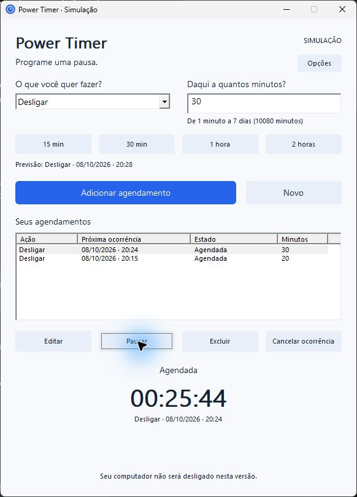

# Power Timer

Agendador minimalista de desligamento, suspensão e hibernação para Windhawk, em desenvolvimento.

A prévia local permite manter vários agendamentos de 1 minuto a 7 dias, editar, pausar, reativar, cancelar e excluir. A lista e os prazos são recuperados ao reabrir. **Esta versão funciona exclusivamente em simulação.** Nenhuma ação de energia real é executada.



As três suítes verificam o agendador, a recuperação e o armazenamento, incluindo falhas de gravação e prevenção de reenvio. Preview e DLL x86 compilam. A integração da versão 0.1.0 no Windhawk 1.7.3 foi validada localmente, incluindo bandeja e recuperação do Explorer. A lista persistente da versão 0.2.0 foi validada no preview; a atualização da instalação no Windhawk ainda está pendente.

- [Validação e limitações atuais](docs/validation/task-03.md)
- [Integração anterior com Windhawk](docs/validation/task-02.md)
- [Preparação e instalação local](docs/installation-local.md)
- [Especificação vigente](.scratch/power-timer-v1/spec.md)
- [Mapa das 13 tarefas aprovadas](.scratch/power-timer-v1/map.md)

No PowerShell 7, na raiz do projeto:

```powershell
./scripts/test.ps1
./scripts/build-preview.ps1
./scripts/build-mod.ps1
```

Os scripts usam o compilador instalado com Windhawk. A interface executável fica em `build/preview/`; fonte única para o editor e DLL de conferência ficam em `build/mod/`. Consulte a instalação local antes de ativar o mod.

Publicação no GitHub e no catálogo Windhawk é uma etapa futura, após validação funcional e visual. O repositório é local, sem publicação até aqui.
